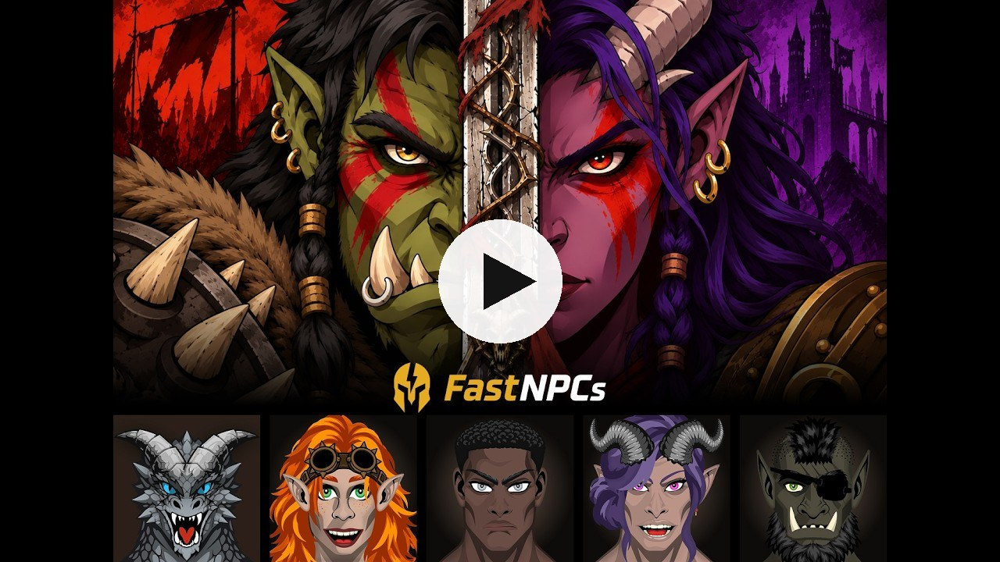
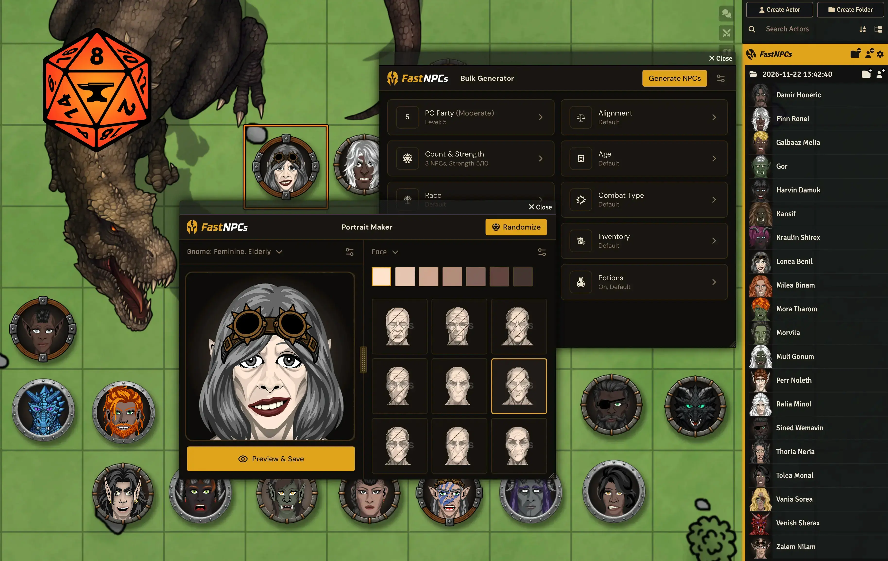
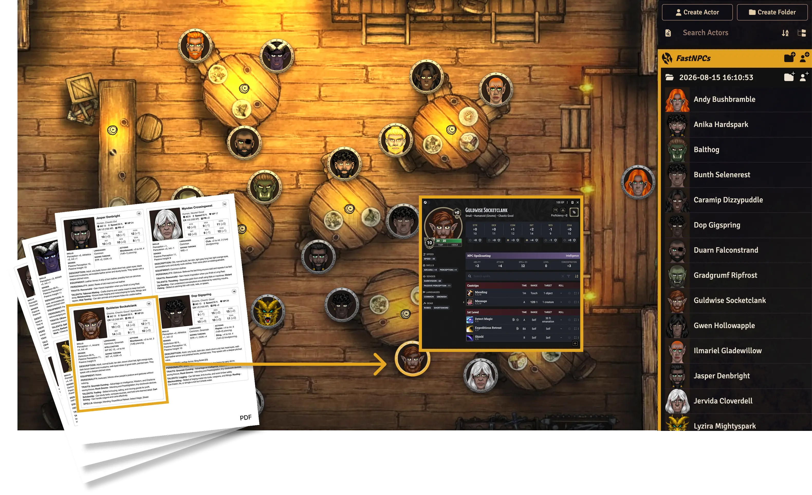

# FastNPCs

FastNPCs creates D&D 5e NPC actors inside Foundry VTT. A batch becomes actors with matching portraits, tokens on the map, and gameplay-ready items, weapons, spells, skills, stats, and descriptions. A FastNPCs account is required.

Open the Portrait Builder and the Bulk Generator from inside Foundry. Generate up to 20 NPCs at a time, with challenge ratings set from the party's size and level. Each NPC is an actor with Foundry equipment, skills, stats, and features. The portrait becomes the token. You can place those tokens on the scene, give them unique borders and colors, and open the portrait tools from a token's controls or the actor sheet, including for an actor that was already in the world.

**No AI is used to generate portrait images.** I hand craft and edit every facial feature by me as SVG artwork: eyes, ears, noses, mouths, hairstyles, facial hair, horns, scars, and more. Each piece is made so it can be recolored, resized, and combined into a face that still holds together. Randomize a face or choose each feature yourself. The library is hundreds of those hand-crafted features, and new ones are added over time.

This repository holds the public Foundry module releases. The module source is not published here.

- Website: https://fastnpcs.com
- Install manifest: https://fastnpcs.com/foundry/module.json
- Terms and privacy: https://fastnpcs.com/legal
- Releases: https://github.com/heathbit/fastnpcs-releases/releases

Foundry VTT 13 and 14, with the Dungeons & Dragons Fifth Edition system. The current module is 1.1.3.

